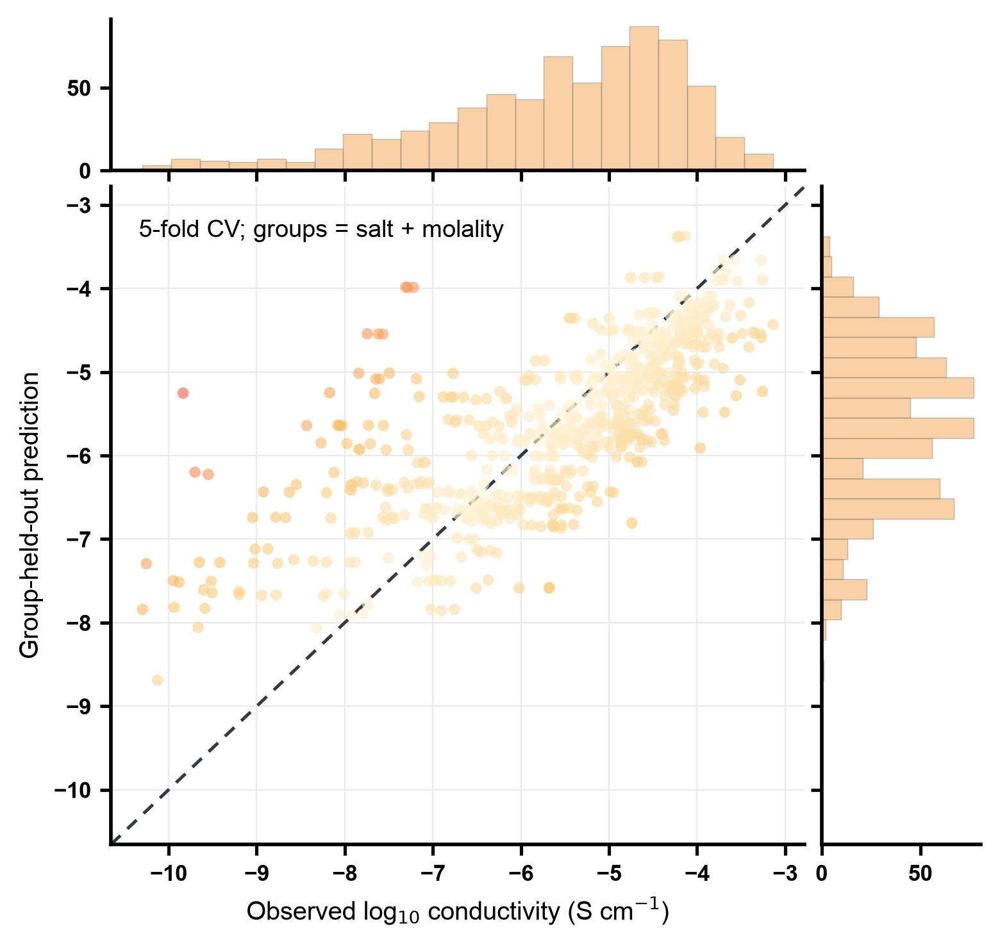
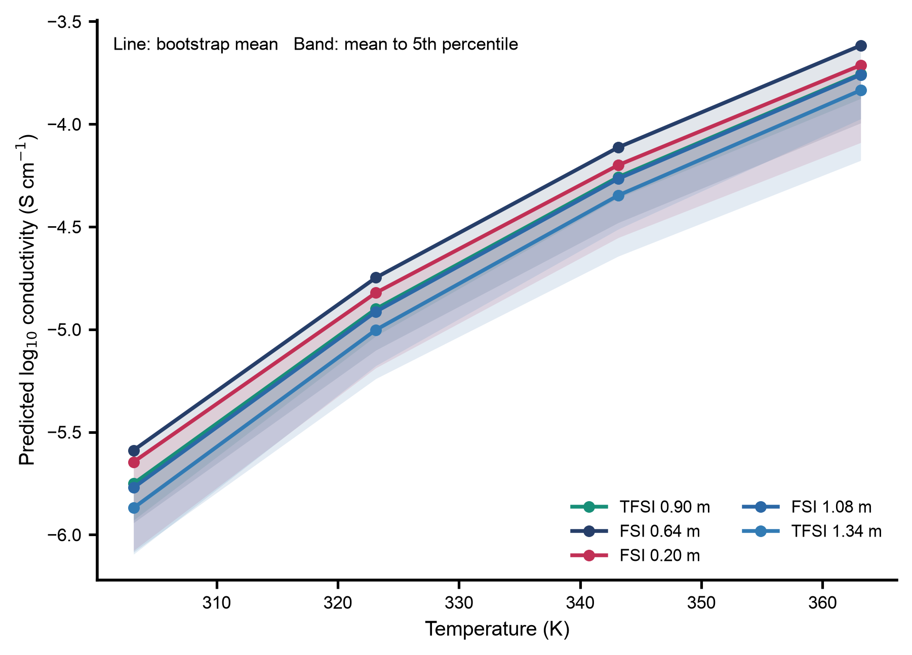

# Experiment B: beyond-repeat-unit complete-system generation

## Executive answer

The existing PolyGen repository can support the proposed direction, but not by
merely extending its conditional label. Its minGPT implementation prepends a
fixed-length binary conductivity token and emits only a repeat-unit p-SMILES.
The reusable pieces are the molecular generator, tokenizer, structural validity
checks, and reproducible runners. A complete-system workflow needs a separate
typed specification layer, feasibility compiler, physics-informed surrogate,
uncertainty model, and robust acquisition policy.

One honest end-to-end slice now runs in this repository. It generates and ranks
complete **80 kDa PCL electrolyte formulations** over salt, molality, and a
303.15--363.15 K operating window using real experimental data. It does not
claim cross-polymer, molecular-weight, architecture, or plasticizer
generalization. PolyGen structures pass through the new schema interface but
are explicitly quarantined as out of distribution.

## Frozen question and estimand

The primary question is whether a physics-informed layer can produce complete,
feasible PCL system specifications and rank them conservatively. The primary
predictive estimand is group-held-out RMSE in log10 conductivity, where every
temperature measurement from the same salt/molality formulation stays in one
fold. The decision estimand is the minimum 5th-percentile predicted log10
conductivity over 303.15, 323.15, 343.15, and 363.15 K.

The immutable design is in `results/experiment-b/config/run_contract.json`.

## Data audit

The source is Ruza and Stolberg's MIT dataset on Zenodo,
<https://doi.org/10.5281/zenodo.16741235>, released under CC BY 4.0. The raw CSV
is retained unchanged and verified by SHA-256
`94e80bdcc2386cd6412618c4bd7857afbfdf37094dc9fa232d321d6401a0b936`.

The file contains 711 measurements, 17 salts, 37 distinct molalities, 32
reported temperature values spanning 29.2--90.2 °C, one PCL repeat unit, and one
molecular weight (80,000 g/mol). It identifies salt, loading, and temperature
effects. It does not identify repeat-unit, MW/DP, architecture, or plasticizer
effects.

## Model and validation

The surrogate uses a fixed-T0 VTF skeleton, `1 / (T - 180 K)`, plus salt,
molality, squared molality, salt/loading interactions, and a regularized linear
fit. Forty bootstrap models resample complete salt/molality groups; uncertainty
therefore includes formulation-support variability rather than treating the
four temperatures as independent replicates.

Five-fold group-held-out validation gives:

| Metric | Value |
|---|---:|
| VTF-informed RMSE, log10(S/cm) | 0.962 |
| Temperature-agnostic null RMSE | 1.261 |
| RMSE improvement from temperature physics | 0.299 |
| MAE, log10(S/cm) | 0.718 |
| R² | 0.539 |

The temperature skeleton materially improves the deliberately weak null, but an
RMSE near one decade is not sufficiently accurate for an autonomous discovery
claim. The current ranking is a batch-prioritization prototype.

## End-to-end generation result

The feasibility compiler generated 576 condition-level system records and 144
unique salt/loading formulations. Every candidate stays within the observed
salt-specific molality range and observed temperature range. The highest
worst-window lower-confidence-bound candidates were:

| Robust rank | Salt | Molality (mol/kg) | Worst-window 5% LCB log10(S/cm) |
|---:|---|---:|---:|
| 1 | TFSI | 0.9000 | -5.930 |
| 2 | FSI | 0.6375 | -5.943 |
| 3 | FSI | 0.2000 | -6.078 |
| 4 | FSI | 1.0750 | -6.086 |
| 5 | TFSI | 1.3375 | -6.096 |

Because the decision is the minimum across temperature, the 303.15 K condition
dominates these rankings. This is expected and makes the operating-window
objective explicit rather than hiding it inside a single 353 K label.

## PolyGen integration result

The first 25 structures from Experiment A's leakage-safe generator were compiled
through the new interface. The audit records RDKit validity and two-ended
polymerization syntax. One malformed generated SMILES is correctly rejected.
All 25 are blocked from the PCL surrogate, including the syntactically valid
ones, because the formulation training set contains only PCL. This is the
scientifically important behavior: a type-compatible structure is not treated
as an in-domain property prediction.

The resulting architecture is:

1. PolyGen proposes repeat units.
2. A system generator attaches controlled DP/MW, architecture, salt, loading,
   additive, and operating-window fields.
3. A feasibility compiler validates chemistry, construction, force-field and
   data-support status.
4. Domain-specific physics surrogates predict transport curves and uncertainty.
5. Robust acquisition ranks only supported systems and routes unsupported ones
   to targeted MD or experiment rather than assigning confident scores.

## Six-dataset decision

| Dataset | Verified role | Decision for this project |
|---|---|---|
| PEDatamine | 5,225 conductivity points across 655 polymer/anion/concentration entries; public repository is MIT licensed, but values are literature-derived | Highest-priority chemistry-plus-formulation training source after row-level provenance and unit audit; do not assume original articles share the repository license |
| MIT PCL formulation | 711 usable rows in the downloaded CC BY 4.0 file; one chemistry and MW, 17 salts | Used now for the first end-to-end formulation/temperature run |
| Negative Li transference (Dryad) | CC0 data; directly varies DP and concentration and contains eNMR/Onsager evidence including negative transference | Best mechanism/OOD challenge set; too small and specialized to be the main conductivity generator training set |
| CALiSol-23 | CC BY 4.0; 13,825 liquid-electrolyte points, 38 solvents, 14 salts | Useful for salt/solvent/concentration/temperature representations and unit-defect tests, not direct polymer transfer |
| Matter-of-Fact | CC BY 4.0 benchmark; 1,376/2,538/4,446 temporal train/validation/test claims | Useful for claim-feasibility evaluation or a TMLR track, not a numeric conductivity surrogate |
| PoLyInfo | Rich polymer identity/processing/property database with access-specific terms; ontology alone is CC BY | Use only through permitted queries or manually curated examples unless explicit bulk-use authorization is obtained; do not mirror into the pipeline |

## What is required for the full proposed model

The next data table must preserve repeated observations of the same chemistry
while varying MW/DP, salt/loading, plasticizer, architecture, and temperature.
Without these crossed observations, a joint network can fit labels but cannot
separate chemistry from formulation or detect rank reversal.

The next defensible milestone is therefore not a larger language-model prompt.
It is a harmonized `system_observation` table with explicit units and provenance,
followed by three isolating arms:

- chemistry-only HTP-MD baseline at the released fixed protocol;
- formulation/temperature model on measured PCL and PEDatamine curves;
- fused model evaluated on chemistry-condition combinations excluded as whole
  systems, with the Dryad DP series as a mechanism stress test.

Only after that gate should DP, salt, loading, and plasticizer tokens be added to
the generative model. Until then, they should be generated by a controlled
enumerator/optimizer and checked by the feasibility layer.

## Reproduction and evidence

Run `./run_experiment_b.sh`. Machine-readable evidence is under
`results/experiment-b/tables/`; plots are in
`results/experiment-b/figures/`; the terminal record is
`results/experiment-b/run.log`. The source audit, CV predictions, model metrics,
all candidate predictions, robust rankings, PolyGen OOD audit, hashes, seed,
environment, and artifact sizes are retained. Three regression tests verify the
source identity, in-support candidate construction, and mandatory OOD block.

## Supported and unsupported claims

Supported: the complete-system software path runs; temperature physics improves
the specified null on this dataset; uncertainty-aware PCL formulation rankings
can be produced; PolyGen outputs can be schema-compiled and safely rejected when
property support is absent.

Unsupported: that TFSI/FSI rankings generalize beyond 80 kDa PCL; that the model
has learned DP, architecture, plasticizer, or chemistry effects; that any new
PolyGen structure will outperform PCL; or that a high-ranked specification can
already be built and simulated without additional force-field and construction
checks.
