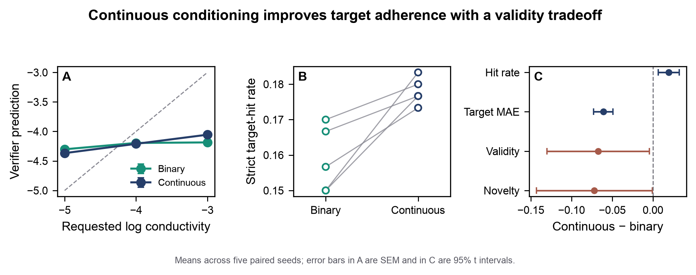
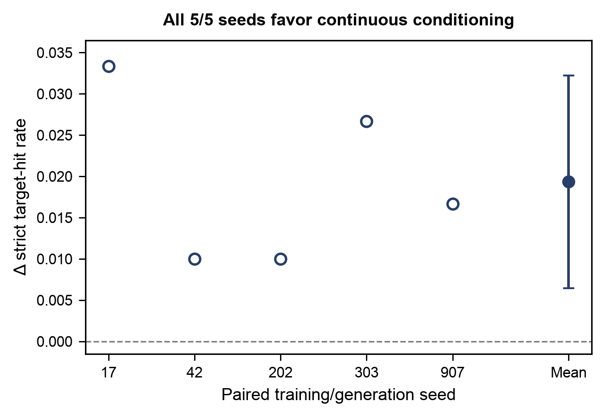
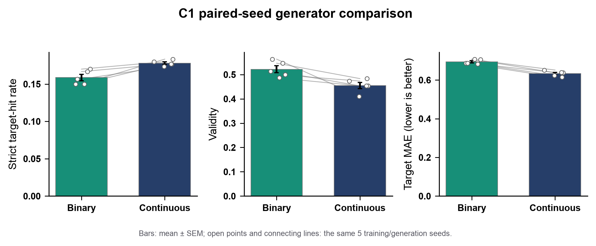
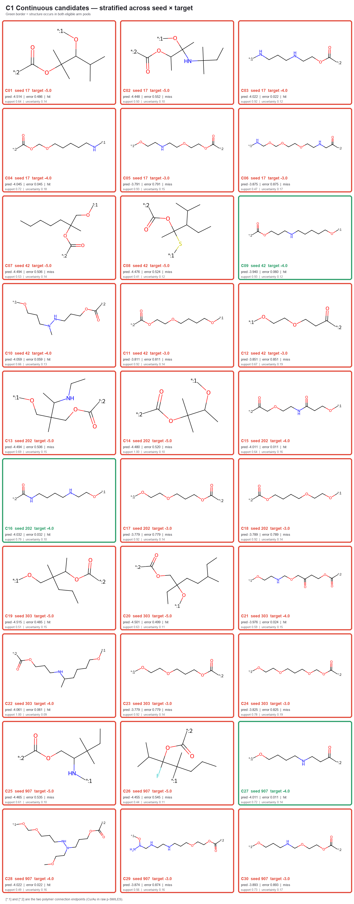
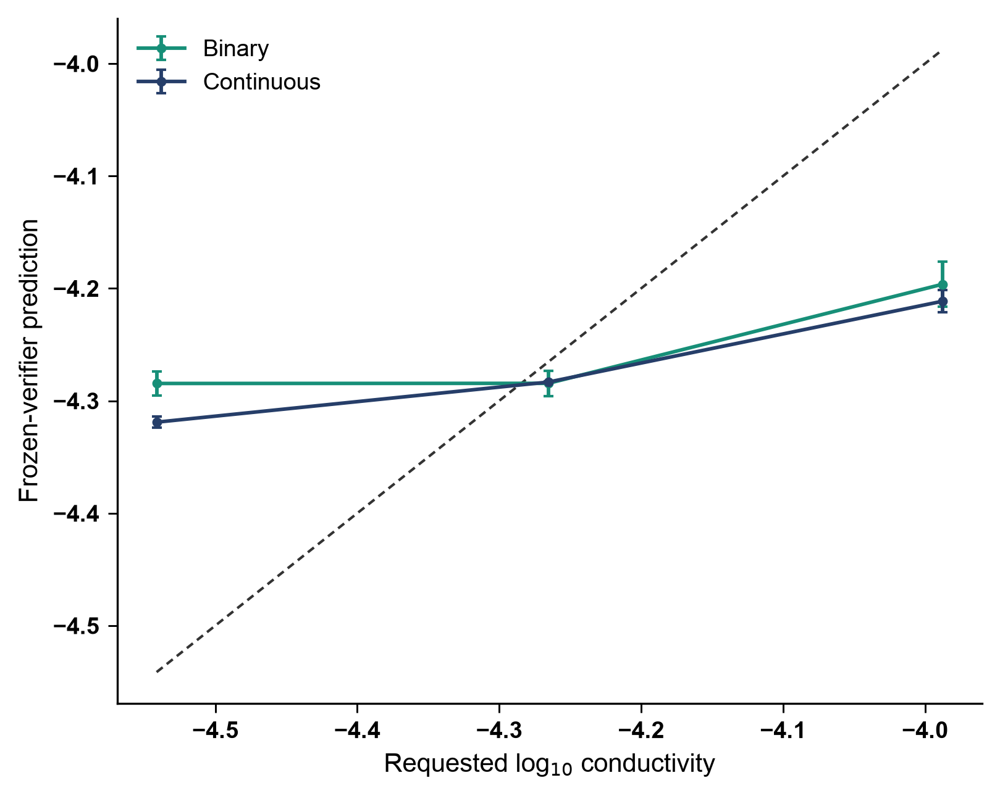
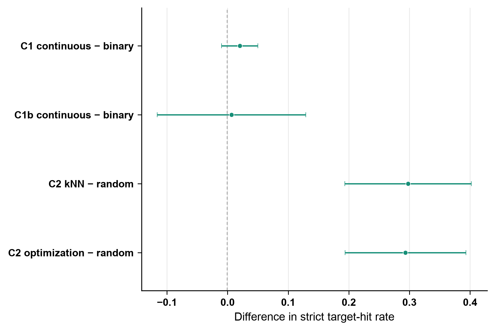

# Experiment C: does richer conditioning beat binary PolyGen?

## Bottom line

The two-stage system now runs end to end with frozen, independent forward
verification, paired seeds, structure/formulation-disjoint tests, uncertainty
and support filters. Five paired C1 seeds now support a reproducible offline
target-adherence gain for continuous conditioning, but the evidence is **not yet
sufficient for a physical discovery claim** because the gain is verifier-defined,
the extreme targets are support-limited, and valid/novel yield decreases.

C1 shows that a continuous soft-prefix follows target ordering more closely and
raises strict target-hit yield in all five paired seeds. C2 shows that
condition-aware formulation selection strongly beats random enumeration under
an independent verifier, but the verifier's held-out-formulation error is too
large to interpret that gain as physical performance. This is a rigorous pilot
and identifies the next data/model gate rather than manufacturing a positive
result.

## C1: continuous chemistry conditioning

Both arms used the same 4,819 generator-training structures, 1,205 untouched
verifier-test structures, nano-GPT architecture, 1,000 optimizer steps, sampling
temperature, five seeds and 300 samples per run. The verifier is a separately
trained 300-tree Morgan-fingerprint model; its test RMSE was 0.157 log10(S/cm).

The prespecified targets were -5, -4 and -3. The -3 target is outside the HTP-MD
range and -5 is at its lower edge, so C1 is retained as the primary result but
also flagged as support-limited. The mean paired strict-hit improvement was
+0.0193 (95% t interval 0.0064 to 0.0322), with all five seeds positive. The
paired t-test was p=0.014, but the distribution-free exact sign test was p=0.0625;
with only five seeds this is exploratory evidence, not a definitive confirmatory
test. Hits were concentrated near -4, so the improvement does not establish
reliable control at the support-limited extremes.

C1b reused the exact frozen checkpoints and evaluated the training-distribution
10th/50th/90th percentiles (-4.541, -4.265, -3.988). Continuous conditioning had
a target–prediction correlation of 0.982 versus 0.867 for binary conditioning,
but mean paired hit-rate improvement was only +0.0067 and was negative in two of
three seeds. The data therefore support improved target ordering, not improved
valid yield.

Candidate visualization is generated automatically from the complete saved C1
sample tables. To avoid a favorable-seed gallery, the rule is frozen at two
eligible, unique structures per arm, seed and target, ranked by target error plus
0.25 times verifier uncertainty. The resulting 30-per-arm five-seed sheets, their
machine-readable index, all eligible unique structures, overlap statistics and
descriptor summaries are stored under `results/experiment-c/c1/candidate_structures/`.
These pictures illustrate chemical output; they do not upgrade surrogate hits to
MD- or experimentally validated discoveries.

Across the five paired seeds, continuous conditioning raised mean strict-hit
rate from 0.1587 to 0.1780 and reduced target MAE from 0.6940 to 0.6331, but
validity fell from 0.5220 to 0.4547 and novelty from 0.5033 to 0.4313. The
continuous arm was monotonic across targets in 5/5 seeds (mean target-prediction
correlation 0.991), compared with 4/5 seeds for binary conditioning (mean 0.873).
Across all five seeds, among candidates passing the common
validity/novelty/support/uncertainty gate, the binary arm produced 746 unique
structures and the continuous arm 622; only 56 were shared (Jaccard 0.043).
The eligible pools had similar median size (13 heavy atoms) and median TPSA
(52.6 A^2). Thus the current difference is mainly a target-adherence versus valid
chemical-yield tradeoff, not evidence that the continuous arm found a clearly
different favorable chemistry class. These are descriptive generated-sample
statistics, not independent replicates.

## C2: conditional PCL formulation generation

C2 compared uniform random enumeration, a condition-space kNN inverse generator,
and VTF-ridge grid optimization over 80 kDa PCL formulations. Splits held out
entire salt/molality groups. Candidate proposal used the VTF-ridge model; final
evaluation used an independent 300-tree verifier that was never exposed to the
proposal objective.

Mean strict-hit rates were 0.114 for random enumeration, 0.412 for conditional
kNN and 0.407 for optimization. Paired improvements over random were +0.298 and
+0.293 respectively, with the same direction for all seeds. However, independent
verifier RMSE on held-out formulations was 1.19--1.30 log units. These yield
differences are therefore implementation evidence, not a reliable experimental
conductivity claim.

## PEDatamine decision

The checked-in snapshot contains 655 system rows, 5,225 positive conductivity
measurements across 22 temperature columns, 78 polymer names, 70 first-component
SMILES, 12 anions, 65 DOI sources and three architecture labels. Mn is present
for 325 rows and Mw for 528 rows.

PEDatamine should be added to the forward-model program because it supplies the
crossed chemistry/formulation/temperature variation absent from HTP-MD and MIT
PCL. It should not yet be concatenated directly with HTP-MD generator rows:

- it is experimental literature data rather than a single MD protocol;
- its SMILES are component descriptors, not standardized two-ended p-SMILES;
- temperature curves and molecular-weight fields are missing unevenly;
- it needs polymer- and DOI-disjoint evaluation to prevent curve and article
  leakage;
- the repository license is MIT, but every derived point must retain source DOI
  and reference attribution.

The new `audit_pedatamine.py` creates a provenance-preserving long table without
imputing missing conditions. That table is the correct starting point for a
multi-domain verifier and a later V2 generator.

## Publishable experiment specification

The current code and evidence are suitable as a reproducible pilot or methods
appendix. A defensible positive paper requires the following frozen next stage:

1. Harmonize PEDatamine into canonical polymer identities, explicit units and
   source-level provenance; map descriptors to p-SMILES only where unambiguous.
2. Train the forward verifier with nested polymer-family and DOI-disjoint splits,
   then require calibration and RMSE thresholds before generator comparison.
3. Repeat the five-seed comparison at a larger fixed budget using only
   in-support targets fixed from training quantiles; the current C1b checkpoint
   reuse is a sensitivity analysis, not a separately trained confirmatory run.
4. Compare binary, continuous, continuous+condition dropout and auxiliary-head
   arms with identical parameter or compute budgets.
5. Treat held-out salt/temperature combinations as a separate estimand from
   held-out polymer structure.
6. Use the Dryad DP series as an external mechanism test, not as training rows.
7. Permit hierarchical chemistry→formulation scoring only where the joint
   verifier reports in-domain support; otherwise route the combination to MD or
   experiment.

## Reproduction and evidence

Contracts are under `results/experiment-c/config/`. C1 and C1b preserve all
samples, checkpoints, split rows, per-target metrics and paired contrasts. C2
preserves all 8,100 method/query predictions and independent-verifier diagnostics.
PEDatamine audit outputs retain source indices, DOI and reference. No historical
Experiment A or B artifact is overwritten.

Supported claim: under the frozen HTP-MD benchmark, continuous conditioning
reproducibly improves verifier-defined target adherence over binary PolyGen
across five paired seeds, with an explicit validity/novelty tradeoff; the richer
two-stage pipeline is executable and auditable.

Unsupported claim: the current offline gain proves superior experimental
conductivity, salt/temperature controllability, or novel complete-system
discovery.
