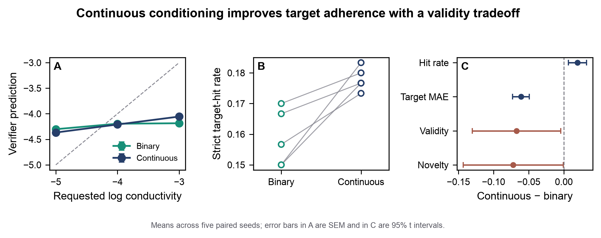
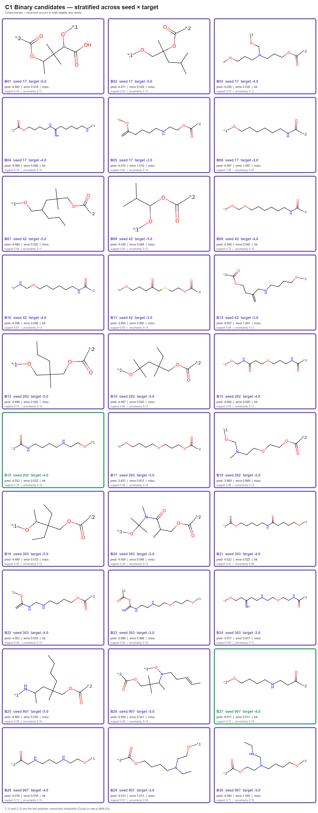
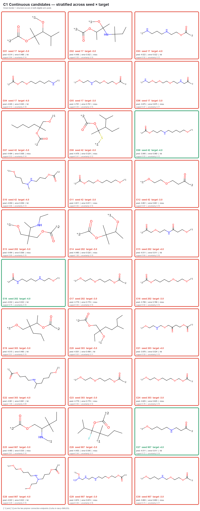
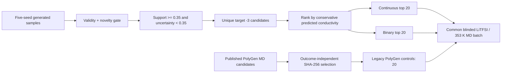

# PolyGen actual-data reproduction

This is a self-contained, actual-data-only reproduction workspace for the public
PolyGen release associated with *De novo design of polymer electrolytes using
GPT-based and diffusion-based generative models*.

The scientific numbers in this folder are not copied from the paper. They are
generated from the machine-readable inputs under `inputs/` or from real execution
artifacts under `results/dev/`. See `DATA_POLICY.md` for the enforceable rule.

## Current milestone: five-seed continuous conditioning

The current research milestone compares the released binary high/low PolyGen
interface with continuous conductivity conditioning under the same HTP-MD split,
model size, 1,000-step training budget, sampling budget, and frozen independent
verifier. The unit of replication is the paired training/generation seed
(`17, 42, 202, 303, 907`), not the individual generated candidate.

| Five-seed C1 outcome | Binary | Continuous | Paired change |
| --- | ---: | ---: | ---: |
| Strict target-hit rate | 0.1587 | 0.1780 | **+0.0193** |
| Target MAE (log10 S/cm; lower is better) | 0.6940 | 0.6331 | **-0.0609** |
| Validity | 0.5220 | 0.4547 | -0.0673 |
| Novelty | 0.5033 | 0.4313 | -0.0720 |

All five paired seeds favor continuous conditioning for strict target-hit rate.
The mean difference has a 95% t interval of `[0.0064, 0.0322]`; because only five
seeds were run, the exact two-sided sign-test result (`p = 0.0625`) is also
reported. The result supports improved **verifier-defined target adherence**, not
yet higher MD or experimental conductivity.



The corresponding seed-level effect plot is available as
[PNG](results/experiment-c/figures/c1_five_seed_primary_effect.png) and
[SVG](results/experiment-c/figures/c1_five_seed_primary_effect.svg). Exact
statistics, captions, and manuscript-ready discussion are under
[`results/experiment-c/publication/`](results/experiment-c/publication/).

### Generated chemistry across all five seeds

Candidate sheets are selected deterministically across every
`arm × seed × target` stratum: two valid, novel, in-support, low-uncertainty
structures per stratum, ranked by target error plus `0.25 × uncertainty`.
This prevents a gallery from being assembled from one favorable seed.

<p align="center">
  
  
</p>

Across the common eligibility gate, the binary arm contains 746 unique
structures and the continuous arm 622; 56 are shared (exact-structure Jaccard
`0.043`). Median heavy-atom count is 13 in both arms and median TPSA is 53.38 Ų
versus 52.60 Ų. The arms therefore explore mostly different exact structures,
but current descriptors do not show a clearly distinct superior chemistry class.

Machine-readable outputs:

- [candidate structure index](results/experiment-c/c1/candidate_structures/candidate_structure_index.csv)
- [eligible-pool structure comparison](results/experiment-c/c1/candidate_structures/structure_comparison.csv)
- [candidate selection manifest](results/experiment-c/c1/candidate_structures/manifest.json)
- [five-seed paired generator comparison](results/experiment-c/figures/c1_candidate_comparison.png)

### Frozen top-20 MD validation queue

The next physical-validation milestone is frozen but **not yet run**. Candidate
ranking uses the conservative score
`predicted_log_sigma - 1.96 × verifier_uncertainty` after the same validity,
novelty, support, and uncertainty gates.



The first five frozen continuous candidates are shown below; the full table is
the authoritative queue.

| Rank | Seed | Repeat-unit p-SMILES | Predicted log sigma | Uncertainty | Support | Conservative score |
| ---: | ---: | --- | ---: | ---: | ---: | ---: |
| 1 | 202 | `O=C([Au])OCCCOCCO[Cu]` | -3.779 | 0.137 | 0.917 | -4.048 |
| 2 | 202 | `O=C([Au])OCCCCOCCO[Cu]` | -3.789 | 0.140 | 0.917 | -4.063 |
| 3 | 17 | `O=C([Au])OCCOCCNCCO[Cu]` | -3.791 | 0.153 | 0.926 | -4.090 |
| 4 | 42 | `O=C([Au])OCCOCCCCO[Cu]` | -3.811 | 0.144 | 0.917 | -4.094 |
| 5 | 202 | `O=C([Au])OCCOCCCCCO[Cu]` | -3.819 | 0.151 | 0.880 | -4.114 |

- [continuous top-20](results/experiment-c/md-validation/continuous_top20.csv)
- [binary top-20](results/experiment-c/md-validation/binary_top20.csv)
- [legacy PolyGen control panel](results/experiment-c/md-validation/legacy_polygen_hash20.csv)
- [prospective 60-structure MD manifest](results/experiment-c/md-validation/md_batch_manifest.csv)
- [MD validation protocol](results/experiment-c/md-validation/MD_VALIDATION_PROTOCOL.md)

The prospective primary comparison is continuous top-20 versus binary top-20
under one randomized, blinded simulation batch with five independent replicas
per structure. Legacy PolyGen is a secondary control. Build or force-field
failures remain in the denominator rather than being silently replaced.

### Progress and claim boundary

| Stage | Status | What it currently supports |
| --- | --- | --- |
| Reproduction and split audit | Complete | Auditable released and structure-disjoint baselines |
| Frozen independent verifier | Complete | Common offline scoring, uncertainty, and support status |
| Five-seed binary vs continuous C1 | Complete | Improved target adherence with lower valid/novel yield |
| Five-seed candidate chemistry sheets | Complete | Deterministic cross-seed chemical output audit |
| PCL formulation prototype C2 | Complete, verifier-limited | End-to-end formulation pipeline execution only |
| PEDatamine audit | Complete | Data basis for later chemistry/formulation/temperature modeling |
| Top-20 MD queue | Frozen, not run | Prospective candidate and control cohorts only |
| Higher physical conductivity claim | Not available | Requires the common-protocol MD experiment |

For the consolidated evidence package, open the
[Obsidian milestone report](evidence/obsidian/experiment-c-five-seed-milestone/Continuous%20conditioning%20beyond%20binary%20PolyGen%20%E2%80%94%20five-seed%20milestone.md),
the [Overleaf handoff](evidence/obsidian/experiment-c-five-seed-milestone/OVERLEAF_HANDOFF.md),
and the [PolyGen alignment TODO](results/experiment-c/publication/POLYGEN_ALIGNMENT_TODO.md).

## Run the complete local pipeline

```bash
./run_end_to_end.sh
```

The command regenerates:

- raw dataset and validation-MD summaries;
- every-candidate replica statistics without omitting or renaming input groups;
- generated-polymer iteration summaries;
- vector plots whose axes, thresholds, counts, and annotations are calculated at
  runtime;
- summaries and plots of actual DEV model runs;
- input and full-package SHA-256 manifests;
- provenance and internal-consistency checks.
- an evidence-derived panel/table coverage matrix that never imports article values.

Only Python's standard library is required for this local aggregation pipeline.

## Result layout

```text
inputs/                 raw machine-readable release and validation files
results/dev/            samples and metrics from real DEV executions
results/tables/         script-generated summaries and provenance manifests
results/figures/        script-generated SVG plots
scripts/                aggregation, verification, and DEV run entry points
patches/                source fixes used to execute the released code
vendor/                 patched upstream PolyGen v1.0.0 source and public minGPT checkpoints
```

The main generated scientific summary is
`results/tables/dataset_summary.json`. Actual model metrics are in
`results/tables/dev_execution_summary.json` and
`results/tables/dev_metrics_long.csv`. `results/tables/artifact_manifest.csv`
hashes every package file except the manifest itself.

The accepted lightweight training proof is under
`results/dev/minGPT-checkpoint-finetune-smoke-seed907/`. Its training loss,
generated samples, evaluation metrics, runtime, environment, and artifact hashes
all come from one real DEV invocation. The matching loss figure is
`results/figures/actual_mingpt_smoke_losses.svg`.

`results/dev/kozo-dev-e2e-probe.json` is a machine-generated live probe of the
DEV backend, nginx gateway, activity-user path, database search, and returned CIF
structure. Its request parameters and every observed response fact are recorded
in the file; no result is copied into this README.

`REPRODUCTION_COVERAGE.md` and
`results/tables/reproduction_coverage.csv` are regenerated from the artifacts
that are actually present. They distinguish completed raw-data reproduction,
real-run analogues, partial evidence, conceptual panels, and missing inputs.
Panel identifiers are scope metadata only; the coverage generator contains no
scientific target copied from the article.

## Re-running models on DEV

The model entry points require all experiment-defining arguments explicitly.
This prevents publication settings from being silently embedded as script
constants:

```bash
python scripts/run_mingpt_checkpoint.py --help
python scripts/run_mingpt_training.py --help
python scripts/run_diffusion1d_training.py --help
python scripts/run_diffusionlm_saved_samples.py --help
python scripts/probe_kozo_dev.py --help
```

For the small checkpoint-fine-tuning smoke used in this package, run:

```bash
./scripts/run_mingpt_smoke.sh results/dev/minGPT-checkpoint-finetune-smoke-rerun 907
```

This executes only 10 optimizer steps and 100 generations. It starts from the
public checkpoint bundled in the release; it does not perform the large training
run or load any numeric value from the article.

The runners default to `vendor/PolyGen-1.0.0`, so a second source checkout is not
required. Experiment-defining parameters remain mandatory and must be supplied by
the caller. Run them inside the prepared PolyGen environment on DEV, write to a
new directory, then copy the resulting JSON/CSV artifacts under `results/dev/`
and rerun `./run_end_to_end.sh`.

## Experiment A: structure-disjoint minGPT split

The released conditional table is balanced before the pipeline performs its
row-random 80/20 split. Audit both the released behavior and the corrected
structure-disjoint behavior with:

```bash
python scripts/audit_mingpt_split.py \
  --input vendor/PolyGen-1.0.0/minGPT/htp_md.csv \
  --output results/experiment-a/split_audit.json
```

For a corrected run, add `--split-policy structure-disjoint --split-seed 42`
to `scripts/run_mingpt_training.py`. The corrected policy deduplicates by exact
p-SMILES, performs a label-stratified 80/20 split, asserts zero structural
overlap, and oversamples the minority class in the training partition only.
The released behavior remains the default for backward compatibility.

The bundled source is the upstream v1.0.0 release with only the changes recorded
in `patches/polygen-v1.0.0-reproducibility.patch`. See `VENDORED_SOURCE.md` for
the inclusion and exclusion policy.

## Experiment B: complete-system formulation prototype

Run the scoped physics-informed PCL formulation pipeline with:

```bash
./run_experiment_b.sh
```

It uses the CC BY 4.0 MIT/Zenodo formulation dataset to generate complete
specifications containing repeat unit, molecular weight, architecture status,
salt, molality, plasticizer status, and temperature. A fixed-`T0` VTF basis,
group-held-out validation, group bootstrap uncertainty, and worst-window lower
confidence bound produce robust rankings. The experiment deliberately blocks
PolyGen-generated repeat units from ranking because the formulation source has
only one polymer chemistry and one molecular weight. See
`EXPERIMENT_B_REPORT.md` for the result and boundary.

## Experiment C: binary versus richer conditioning

Run `./run_experiment_c.sh` to reproduce the paired binary/continuous chemistry
generator comparison, support-aware frozen-checkpoint follow-up, PCL formulation
baseline comparison, PEDatamine audit, deliberately blocked hierarchical demo,
paired quantitative figures, deterministic stratified polymer structure sheets,
five-seed publication statistics (when the checked-in 202/303 extension is
present), and artifact verification. The complete interpretation and publication
gate are in `EXPERIMENT_C_REPORT.md`.

## What is and is not compared

Actual released data and actual DEV output are reported exactly as computed. A
paper-only number is not imported merely to create a numeric delta. Consequently,
the package can demonstrate execution, data aggregation, and internal
reproducibility, but it does not claim that unavailable publication arrays or
checkpoints have been recreated. Details are in `AUDIT.md`.
