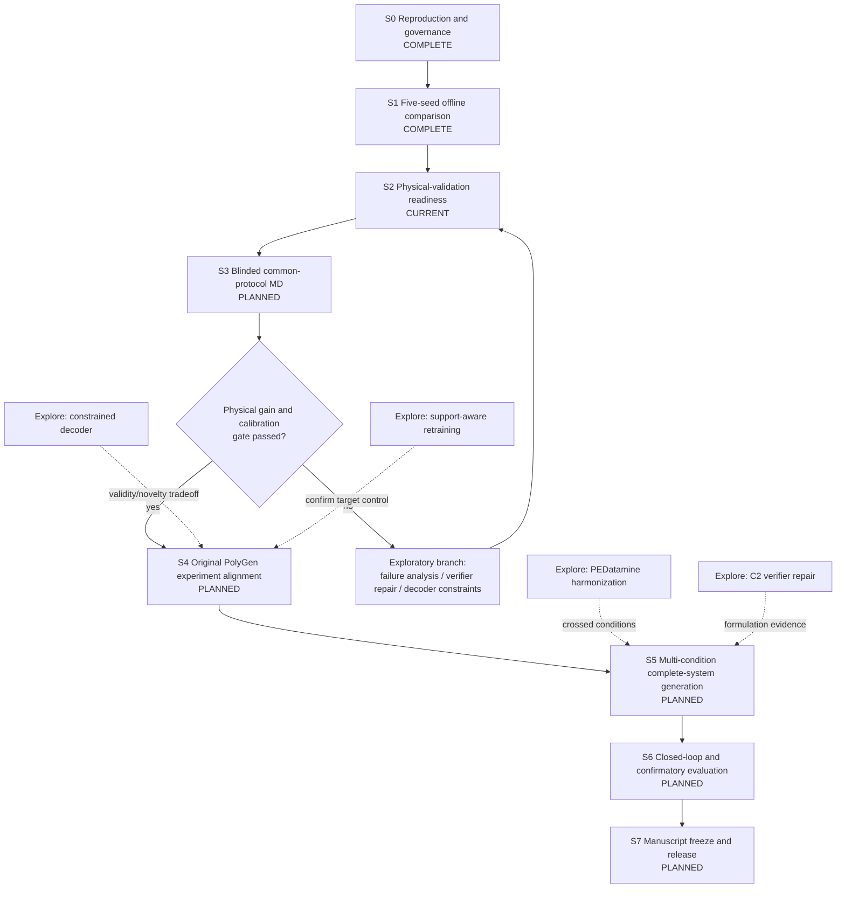

# PolyGen beyond-binary research blueprint

This document is the canonical research roadmap for the repository. It translates
[`POLYGEN_ALIGNMENT_TODO.md`](results/experiment-c/publication/POLYGEN_ALIGNMENT_TODO.md)
into staged, reviewable gates. Agents and contributors should update this file and
[`research/blueprint/status.json`](research/blueprint/status.json) in the same PR
whenever evidence changes a stage, claim, manuscript section, or next-stage decision.

**Current position:** Stage S2 — physical-validation readiness. The five-seed
offline comparison and prospective MD cohorts are frozen; exact PEO/build details,
force-field coverage, and buildability qualification remain open before MD launch.

## Research question and claim ladder

Primary question:

> Does continuous, multi-condition generation improve useful polymer-electrolyte
> discovery over binary high/low PolyGen when candidates are evaluated by an
> independent verifier and ultimately by common-protocol molecular dynamics?

Claims must advance in this order:

1. **Executable:** the pipeline produces auditable candidates and specifications.
2. **Offline-controlled:** continuous conditioning improves frozen-verifier target adherence.
3. **Physically validated:** prospectively selected candidates improve common-protocol MD outcomes.
4. **System-level controlled:** chemistry, formulation, temperature, and specification can be controlled jointly in-domain.
5. **Self-improving:** feedback improves the next generation under a sealed evaluation protocol.

Do not use “higher conductivity” or “discovery” for new candidates until Stage S3
passes. Before then, use “verifier-defined target adherence.”

## Blueprint map



## Stage summary and paper mapping

| Stage | Status | Question answered | Primary paper location | Exit artifact |
|---|---|---|---|---|
| S0 | Complete | Can the released PolyGen evidence and splits be reproduced without hidden leakage? | Methods: data/provenance; Supplement: reproduction audit | Audited inputs, split tests, manifests |
| S1 | Complete | Does continuous conditioning outperform binary labels under one frozen offline verifier? | Results 1: continuous conditioning; Fig. 1–2; Table 1 | Five-seed paired analysis and candidate audit |
| S2 | Current | Are candidate cohorts and simulation contracts sufficiently frozen to start unbiased MD? | Methods: candidate selection and MD preregistration | Build-qualified frozen MD manifest |
| S3 | Planned | Do continuous top candidates outperform binary and legacy controls in common-protocol MD? | Results 2: physical validation; MD figure/table | Blinded MD results and verifier calibration |
| S4 | Planned | Which gains survive exact alignment with the original PolyGen experiment suite? | Results 3 and Supplement: model/metric ablations | Six metrics, architecture and pretraining alignment |
| S5 | Planned | Can the method control complete polymer-electrolyte systems rather than repeat units only? | Results 4: multi-condition system generation | Calibrated multi-domain verifier and held-out-condition tests |
| S6 | Planned | Does MD feedback improve later generations without contaminating evaluation? | Results 5: closed-loop discovery | Two feedback iterations plus sealed test |
| S7 | Planned | Are all claims, artifacts, and limitations ready for publication? | Full manuscript, data/code availability | Frozen manuscript evidence release |

## Stage gates and acceptance criteria

### S0 — Reproduction and governance

**Question:** Is the baseline trustworthy and auditable?

- [x] Released inputs are immutable and provenance is documented.
- [x] Released leakage behavior and corrected structure-disjoint split are tested.
- [x] Binary minGPT baseline runs with explicit experiment-defining arguments.
- [x] Machine-readable coverage distinguishes reproduced, partial, analogue, and unavailable evidence.

**Acceptance:** all repository tests pass; artifact hashes and data sources are recorded;
no paper-only value is inserted as computed evidence.

**Paper response:** establishes the reliability of Methods and Supplementary reproduction claims.

### S1 — Five-seed offline comparison

**Question:** Does continuous conditioning improve offline target adherence over binary PolyGen?

- [x] Five paired seeds use identical training/test rows, budgets, and verifier.
- [x] Seed is the inferential unit; candidate rows are not treated as replicates.
- [x] Primary hit-rate effect, target MAE, validity, novelty, OOD, and uncertainty are reported.
- [x] Five-seed candidate sheets and exact structure-pool comparisons are generated automatically.
- [x] Claim boundary explicitly states the result is verifier-defined, not physical validation.

**Acceptance:** `results/experiment-c/verification.json` is `pass`; all five seed
pairs are present; figures/tables are reproducible; both benefit and validity/novelty
tradeoff appear in Results and Discussion.

**Finding:** strict hit rate improves from 0.1587 to 0.1780 (+0.0193), while
validity and novelty decrease. This motivates both MD validation and a constrained-generation branch.

### S2 — Physical-validation readiness

**Question:** Can MD begin without post-selection bias or unresolved build ambiguity?

- [x] Freeze continuous top-20 using a prespecified conservative score.
- [x] Freeze binary top-20 under the identical rule.
- [x] Freeze an outcome-independent legacy PolyGen control panel.
- [ ] Recover and freeze exact PEO, LiTFSI, loading, DP/chain, cell, force-field, equilibration, production, and estimator specifications.
- [ ] Run deterministic polymer construction and force-field coverage checks for every cohort member.
- [ ] Record build/parameterization failures as outcomes; do not silently replace candidates.
- [ ] Assign blinded IDs, randomized batch order, replica seeds, resource estimates, and rerun policy.
- [ ] Freeze the MD analysis script on synthetic/smoke outputs before real outcomes are read.

**Acceptance:** every manifest row is either `READY` or a retained, classified
failure; all protocol fields and replica seeds are immutable; a dry-run builds at
least one member from every cohort; the analysis code passes a synthetic contract test.

**Paper response:** closes selection/protocol ambiguity in Methods and prevents outcome-driven candidate replacement.

**Suggested implementation branch:** `stage/s2-md-readiness`.

### S3 — Blinded common-protocol MD

**Question:** Are continuous candidates physically better under equal simulation conditions?

- [ ] Run continuous 20, binary 20, legacy 20, and PEO under one randomized protocol.
- [ ] Use five independent replicas per structure; preserve failed and incomplete runs.
- [ ] Aggregate at structure level and report bootstrap confidence intervals and permutation tests.
- [ ] Report conductivity, lower-confidence-bound yield, build success, and transference number where identified.
- [ ] Compare verifier prediction with MD: rank correlation, MAE, interval coverage, and OOD failures.
- [ ] Apply one preregistered long-MD escalation rule identically across cohorts.

**Acceptance:** blinded cohort labels remain sealed until completion/quality-control
rules are applied; the primary continuous-versus-binary estimand is reported for
all frozen structures; denominator flow is complete; protocol deviations are listed.

**Decision gate:**

- If continuous improves MD outcome with acceptable build yield and calibration,
  advance the physical claim and proceed to S4.
- If not, retain the negative result and open a scoped failure-analysis branch;
  do not retune on MD outcomes without defining a new prospective test.

**Suggested branch:** `stage/s3-blinded-md`; exploratory failures use
`explore/s3-<mechanism>` and must not modify the frozen primary analysis.

### S4 — Original PolyGen alignment and generator repair

**Question:** Is the new contribution stronger than an incompletely reproduced baseline?

- [ ] Implement exact uniqueness, synthesizability, similarity, and diversity definitions.
- [ ] Reproduce unconditional generation control.
- [ ] Compare minGPT, 1D diffusion, and diffusion-LM under recorded budgets.
- [ ] Reproduce or justify an alternative to the 100,000-candidate regime.
- [ ] Reproduce ether-present/carbonate-absent conditioning and joint conditioning.
- [ ] Reproduce PI1M pretraining plus HTP-MD fine-tuning and limited-data studies.
- [ ] Reconstruct the full candidate funnel and all denominators.
- [ ] Retrain binary/continuous arms on support-aware targets with a prespecified seed count.
- [ ] Test condition dropout, auxiliary prediction head, and constrained decoder under equal compute.

**Acceptance:** each original-paper experiment is `reproduced`, `real-run analogue`,
or `unavailable with reason`; no missing arm is described as equivalent; the selected
new model improves a frozen multi-metric objective without sacrificing constructability.

**Paper response:** supports the model comparison, ablation, and Related Work claims.

**Possible exploratory branches:** `explore/s4-constrained-decoder`,
`explore/s4-support-aware-targets`, `explore/s4-pretraining`, and
`explore/s4-diffusion-baselines`. Only preregistered winners return to the main stage.

### S5 — Multi-condition complete-system generation

**Question:** Can the framework move beyond repeat-unit-only generation?

- [ ] Harmonize PEDatamine with units, polymer identities, DOI provenance, and missingness retained.
- [ ] Train a calibrated multi-domain forward model for chemistry, salt, loading, temperature, MW/DP, and architecture where identified.
- [ ] Pass polymer-family/DOI-disjoint accuracy, calibration, uncertainty, and support gates.
- [ ] Test held-out temperature interpolation and held-out condition combinations separately from unseen structures.
- [ ] Upgrade C2 until its held-out-formulation verifier passes a prespecified gate.
- [ ] Validate hierarchical chemistry → formulation generation only for jointly in-domain systems.
- [ ] Add DP/MW consistency, architecture, polymerizability, force-field coverage, and build success to the hit definition.

**Acceptance:** every claimed controllable variable varies in training data and has
an explicit held-out test; the joint verifier passes frozen quality thresholds;
complete-system target-hit rate is reported with uncertainty and support.

**Paper response:** provides the central “beyond repeat unit” contribution.

**Possible branches:** `data/s5-pedatamine-harmonization`,
`explore/s5-multidomain-verifier`, `explore/s5-c2-repair`.

### S6 — Closed-loop and confirmatory evaluation

**Question:** Does feedback improve generation rather than merely recycle verifier preferences?

- [ ] Append MD outcomes, including failures, to a versioned table.
- [ ] Compare no-feedback, random-feedback, uncertainty, and expected-improvement policies under paired budgets.
- [ ] Run at least two feedback iterations.
- [ ] Report mean, lower confidence bound, diversity, validity, build failure, and regret per iteration.
- [ ] Keep a sealed external test panel inaccessible to acquisition and early stopping.
- [ ] Execute the preregistered confirmatory seed count/power plan.

**Acceptance:** the final sealed test is opened once; improvement persists under
independent physical evaluation; all adaptive choices and iteration boundaries are auditable.

**Paper response:** supports “self-improving” and robust-discovery claims.

### S7 — Manuscript freeze and release

**Question:** Can every manuscript claim be traced to immutable evidence?

- [ ] Freeze manuscript claim table and figure/table numbering.
- [ ] Report requested → parsed → valid → novel → in-domain → unique → buildable → MD-complete → hit denominators.
- [ ] Release configs, environment, checkpoints, split rows, manifests, failures, and analysis scripts.
- [ ] Re-run artifact verification and Obsidian/Overleaf handoff validation from a clean checkout.
- [ ] Resolve or explicitly preserve every negative and contradictory result.

**Acceptance:** a clean environment reproduces every final table/figure or labels it
as external/unavailable; the manuscript contains no claim above its evidence tier.

## PR and agent maintenance protocol

Every research PR must:

1. Name one **primary stage ID** (`S0`–`S7`) and optional exploratory branch.
2. State the research question and manuscript section affected.
3. Distinguish implementation progress from scientific evidence.
4. List new findings, null/negative findings, risks, and unresolved interpretation.
5. Link exact artifacts and specify the independent statistical unit.
6. Update checklist boxes only when the stage acceptance evidence exists.
7. Update `research/blueprint/status.json` if status, current stage, evidence,
   blockers, or next target changed.
8. State whether the PR changes a frozen protocol; after S2 freeze, such changes
   require a deviation record and cannot silently alter the primary estimand.
9. End with the next blueprint target, not merely “future work.”

Use [`.github/pull_request_template.md`](.github/pull_request_template.md). Validate
the machine-readable state with:

```bash
.venv/bin/python scripts/validate_research_blueprint.py
```

## Status semantics

- `complete`: all acceptance criteria passed with linked evidence.
- `current`: active gate; some acceptance criteria remain open.
- `planned`: scoped but not started or only exploratory work exists.
- `blocked`: cannot proceed without named data, infrastructure, or decision.
- `superseded`: retained for history with replacement stage/evidence identified.

Only one stage may be `current`. Exploratory branches do not advance the current
stage until their result is accepted through a PR and incorporated into the frozen plan.
