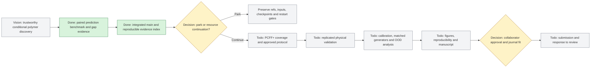

# PolyGen continuation: handoff for Hisa

**Recommendation: park new compute; keep the benchmark and evidence ready to resume.** The immediate value is a reproducible study of conditional polymer generation and verifier limits. A physically validated discovery or self-improving loop remains future work. This is Yi Cao's handoff; agent checks are not Hisa's scientific sign-off.

Legend: green = done with evidence; blue = in progress; yellow = human decision; gray = todo. No completion dates are assumed.

| Step / owner | Dependency and acceptance | Entry point / relative effort |
|---|---|---|
| Done — Yi's existing prediction evidence, checked by agent | Frozen Q80, paired seeds, interpolation/upper-tail/extrapolation artifacts; no physical extrapolation claim | `results/extrapolation/verification.json`, `results/upper-tail/ACCEPTANCE_AUDIT.md`, `evidence/gap-analysis-20261016/PROVENANCE.csv`; already available |
| Done — Yi handoff integration / agent verification | PR #14 normally merged; old branch tips archived under verified tags; legacy PRs closed as superseded. Scientific sign-off remains separate | `HANDOFF.md`, `docs/handoff/branch_retirement_receipt.json`; completed |
| Decision — Hisa / project lead | Park by default. To continue, assign compute/parameterization owners and agree minimum paper scope. Data sharing/licensing and journal choice need humans | `docs/handoff/SPEC.md`; small coordination, outcome unresolved |
| Todo — assigned parameterization owner; Yi evidence handoff | Candidate-specific topology, typing, charges and all bonded/nonbonded coefficients; PEO+LiTFSI positive and phosphorus negative controls; run-0 acceptance; PCFF+ currently NO_GO | `evidence/gap-analysis-20261016/evidence/scripts/audit_pcff_plus_bundle.py`; large, external tooling dependent |
| Todo — Hisa/project owner approves; assigned simulation owner executes | Freeze thresholds and analysis before new data; primary PCFF+, PFP secondary; candidate strata, 5 replicas/structure, convergence and failures retained | `evidence/gap-analysis-20261016/assets/tables/T6_freeze_card.csv`, `TOP1_MD_VALIDATION_DESIGN_ZH.md`; large |
| Todo — assigned analyst; Hisa scientific review | Recover missing PFP trajectory hashes or keep smoke status. Execute approved stratified MD; report uncertainty at independent replica/seed level, not candidate-row pseudo-replicates | `results/extrapolation/md_batch_manifest.csv`, `evidence/gap-analysis-20261016/assets/tables/T4_md_funnel.csv`; large |
| Todo — generator collaborators (Raul/MolMiner; Amanda/WeeMiner only if they accept); Yi's benchmark specification | Same support, paired seeds, budget, verifier and independent checkpoint-selection rule. Existing 5/20/50-epoch MolMiner runs are engineering evidence, not final leaderboard | `evidence/gap-analysis-20261016/STRICT_MOLMINER_SMOKE.md`, T12–T14; medium/large |
| Todo — assigned data/ML owner | Obtain permitted PI1M input, complete full-source near-duplicate audit, remove exact/near leakage; freeze family/scaffold OOD splits; controlled representation/pretraining ablations | A9/A10 in `evidence/gap-analysis-20261016/TODO_AND_ACCEPTANCE.md`; large |
| Todo — assigned analyst | Recompute residual calibration, decision value and one closed-loop update from physical labels; report null results and verifier ceiling; never infer physical failure from zero RF crossings | A2/A6/A7 ledger; large, depends on MD |
| Todo — manuscript lead assigned by Hisa, contributors review own scope | Replace F7/F8 synthetic visuals with real ablation/decision evidence or remove their claims. Final figures/tables, captions, methods, uncertainty, source receipts, environment and independent clean rebuild | `evidence/gap-analysis-20261016/PUBLICATION_PROSE.md`, `overleaf_draft/`; medium |
| Decision — all authors / publication owner | Confirm contributions, licenses and data release; choose journal based on actual achieved claim tier; approve exact manuscript/figures and reproducibility package | Overleaf historical staging is not verified current; medium review |
| Todo — publication owner | Submit approved package, retain submission receipt/version, answer reviewers with versioned evidence; add acceptance/DOI only after actual outcome | No submission performed or implied; variable effort |

## Minimal restart

1. Open canonical `main` and `HANDOFF.md`, inspect registry gates and the merged integration receipt. Do not resume from old Hub/grid notes.
2. Run `python3 registry/build_registry.py`, then `python3 scripts/validate_research_blueprint.py` and the checks in `docs/handoff/VALIDATION.md`.
3. Inspect the candidate PCFF+ audit and T6 freeze card. Assign an owner and obtain actual scientific approval before any new MD.
4. Use the isolated kozo handoff checkout recorded in the external receipt; the historical `/home/yi/PolyGen-reproduction-grid` path is absent. No legacy directory was overwritten.
