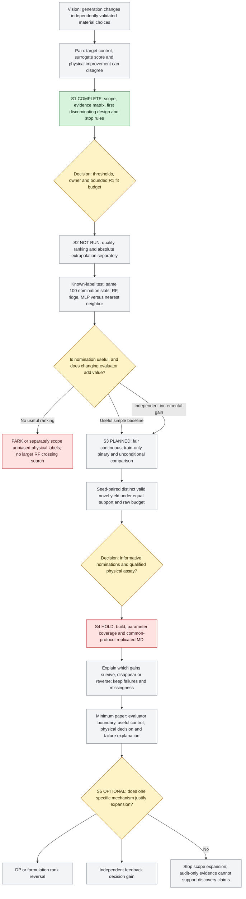

# Paper roadmap: from conditional control to independently useful decisions

**Pitch:** establish when continuous conditioning changes a physically testable polymer-electrolyte decision beyond a nondegenerate binary or reranking baseline, and explain when an apparent advantage comes from evaluation, data support or selection. The intended reader should learn whether to improve the generator, change the evaluator, purchase independent labels or stop.

Primary audience: materials inverse-design researchers. Secondary audiences: offline optimization/OOD evaluation and autonomous-discovery teams. Agent relevance concerns evidence-aware decisions; no agent planning capability is claimed. Polymer/electrolyte scientists become a core audience through independent transport evidence and a physical explanation. The full user-selected positioning and plan are preserved in [DISCUSSION_SOURCE_ZH.md](DISCUSSION_SOURCE_ZH.md).

## Live stage status and evidence boundary

| Stage | Current state | Scientific question / acceptance | Next input and proposed responsibility |
|---|---|---|---|
| S1 — scope and discriminating design | **Complete as design artifacts** | Article goal, evidence/claim matrix, first-round design and go/no-go table exist; source/package hashes verified | [Audit](STAGE1_VERIFICATION.json). Stage-1 packaging PR contains the four original documents; human scientific acceptance remains pending |
| S2 — evaluator qualification | **Blocked / not run** | Can an evaluator allocate 100 known-label nomination slots usefully, and is a change better than nearest neighbor? Separate ranking, value extrapolation and uncertainty | Up to 54 predictor fits proposed, zero executed here. Accept/revise thresholds; name analyst/reviewer; decide bounded resources |
| S3 — fair conditional generation | **Planned / not run for this new design** | Continuous versus train-only binary versus unconditional/common reranking; matched source/seed/raw budgets; all-request distinct-valid-novel yield | Proceed only if the evaluator/independent-label design justifies comparison. Fragment requires matched support and consenting collaborator |
| S4 — physical decision transfer | **HOLD / not run** | Nomination advantages survive parameterization, construction and common-protocol independent transport measurements, or an informative failure is measured | Assigned parameterization/simulation owner; accepted protocol, controls and convergence. Missing is not low conductivity |
| S5 — one mechanistic extension | **Optional, unselected** | Choose DP/formulation rank reversal **or** independent feedback only if minimum results reveal a discriminating hypothesis | Hisa/project lead and consenting domain/method collaborator; no automatic assignment to Yi/Amanda/Raul |

S1 means the research-design deliverables are complete. It does not mean the proposed R1 study has run, thresholds are approved, or someone supplied personal human sign-off. Historical C1 and RF audits remain context, not completion of the new S2–S4 contracts.

<!-- MERMAID_START -->

Legend: green = verified design delivery; yellow = decision; gray = unrun work/conditional conclusion; red = HOLD/park. No new scientific execution is marked complete.

## Results needed for the paper

1. Evaluator identifiability and known-label decision quality.
2. Useful control gain after fair baseline, support and budget controls.
3. Distinct executable candidates supported by independent physical evaluation.
4. A failure explanation that changes the next action.

RF convex-range restriction alone is a known-method audit, not evidence that generative AI cannot extrapolate. A property/chemistry/specification/evaluation-transfer claim must name its independent test. If no independent decision evidence emerges, narrow to an evaluation note/module or park the full discovery paper.

## Canonical progress and updates

The paper-scoped [SQL registry](../../registry/paper/README.md) records append-only source records, stages, decisions, reviews and typed result summaries. Existing `registry/output/polygen_evidence.sqlite` remains unchanged as the historical evidence index. Neither index manufactures scientific acceptance.

Read `python3 registry/paper/progress.py query stages`; register each future result using `record --input <versioned-record.json>`, then review generated queries and the stage implication before committing. No silent background monitoring is installed.

## Review stack

- Parent [PR #16](https://github.com/yicao-tri/PolyGen-reproduction/pull/16): positioning, roadmap and SQL workflow → main.
- [Stage 1 PR #17](https://github.com/yicao-tri/PolyGen-reproduction/pull/17): the four original design documents and their SQL evidence event → parent roadmap branch.

The green S1 node is backed by the [source-verified four-document package](https://github.com/yicao-tri/PolyGen-reproduction/tree/codex/stage1-design-20261124/docs/paper/stage1). Review the parent first; after merging it, retarget the child to main. Design completion does not grant execution approval.
